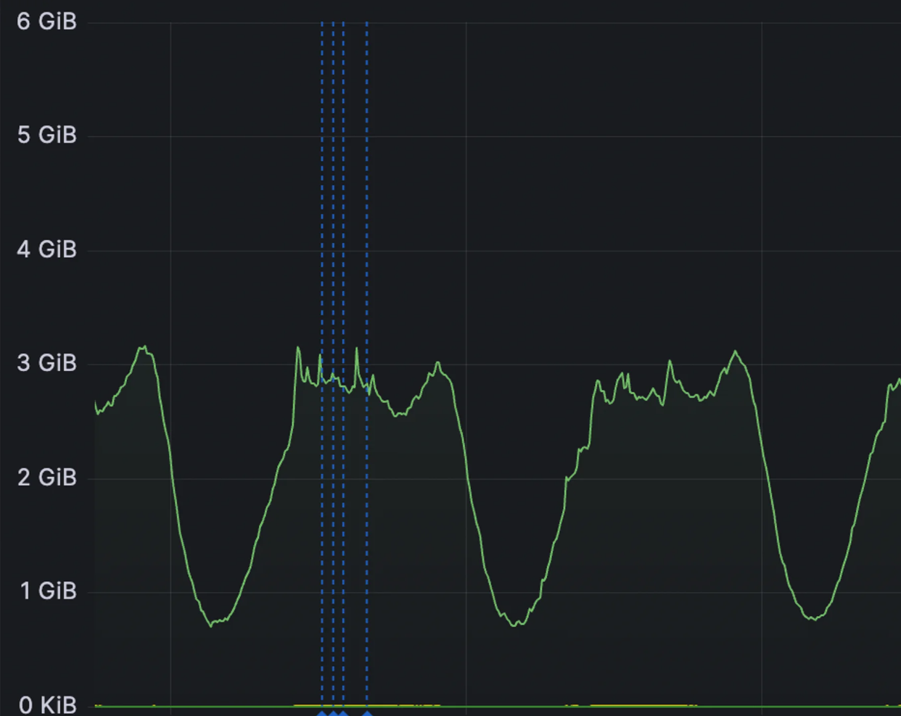
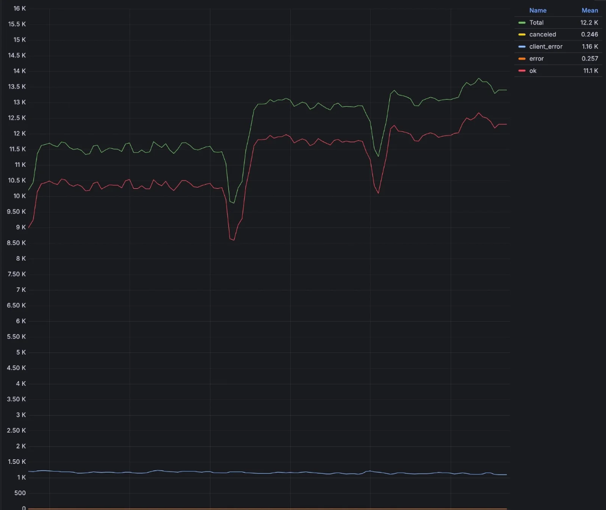
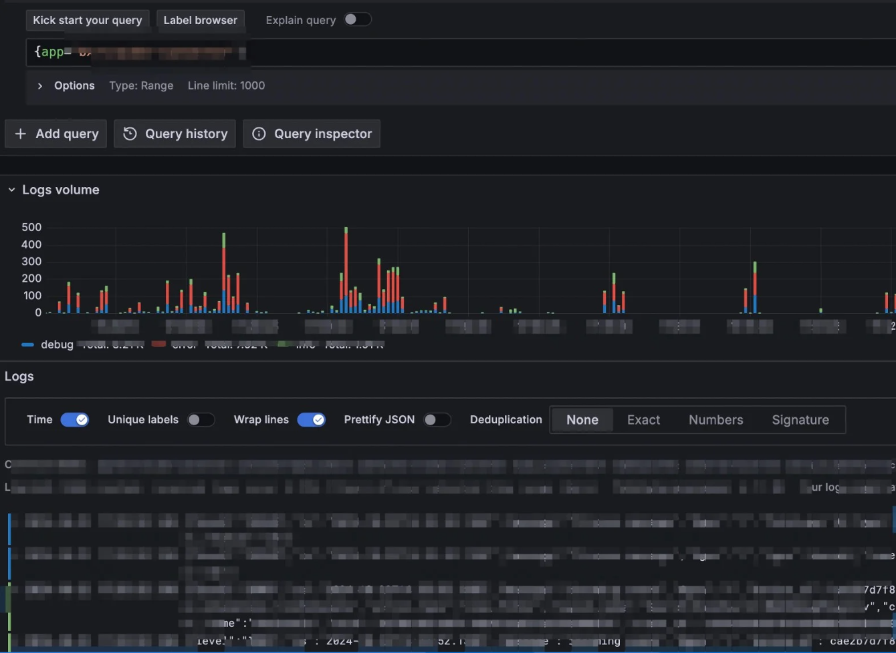
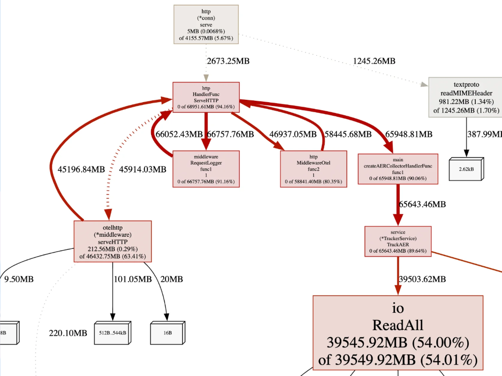
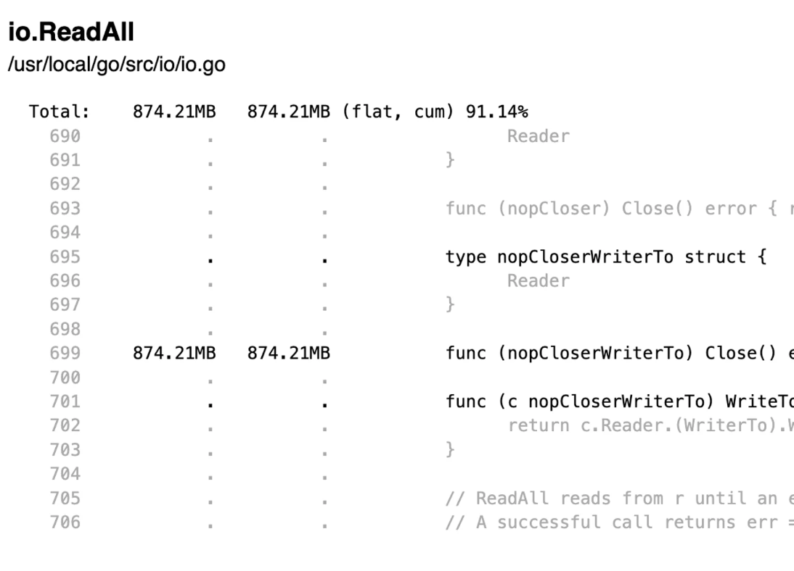

<!-- _class: lead -->
<!-- _paginate: false -->
<!-- _footer: "" -->

# pprof в Go

Как найти утечку памяти, пока процесс ещё жив

Инцидент с прода, демо `*_leaks`, diff двух профилей

---

# О чём поговорим

1. Разбор инцидента на проде
2. План разбора: метрики, логи, горутины, pprof
3. Разберем причины утечек памяти
4. Diff двух профилей
5. Шпаргалка: heap, CPU, goroutine, diff
6. Частые причины роста памяти

---

<!-- _class: shot -->

# Память росла до лимита пода

<div class="columns">
<div>

Рестарт возвращал сервис ненадолго.

График памяти — повод открыть разбор. Откуда байты, на нём ещё не написано.

</div>
<div>



</div>
</div>

---

# План разбора

**1. Метрики: RPS, ошибки, размер тела**
Память и горутины — на том же окне. Прямая вверх при ровном RPS и ровном размере тела — накопление. Полка после пика — рабочий объём кэша или пула соединений.

**2. Логи**
Паника, таймауты, обрывы соединений к downstream.

**3. Состояние горутин**
Число и стеки, повторённые тысячи раз.

**4. pprof на проде**
heap и goroutine снимаем, пока процесс жив. Дальше Graph и Source.

---

<!-- _class: shot -->

# Шаг 1. RPS, ошибки, размер тела

<div class="columns">
<div>

RPS объясняет рост только вместе с размером ответа и ошибками.

Ровный трафик и растущая память — идём в логи и рантайм, а не в масштабирование.

</div>
<div>



</div>
</div>

---

<!-- _class: shot -->

# Шаг 2. Логи

<div class="columns">
<div>

Ищем панику, таймауты, `connection reset`, рост времени downstream.

Дальше смотрим горутины и в том случае, когда в логах тихо: незакрытый Body часто молчит до исчерпания памяти или файловых дескрипторов.

</div>
<div>



</div>
</div>

---

# Шаг 3. Состояние горутин

- Метрика числа горутин рядом с графиком памяти
- Дамп: `/debug/pprof/goroutine?debug=1`
- Утечка — повторяющийся стек с большим счётчиком
- У клиента с незакрытым Body их два: `readLoop` и `writeLoop`. `conn.serve` живёт в downstream

`debug=2` печатает аргументы кадров шестнадцатеричными словами. Полный дамп в общий канал лучше не класть.

Несколько `readLoop` — обычный пул keep-alive. Тысячи при ровном RPS — соединения не возвращаются в пул.

---

<!-- _class: shot -->

# Шаг 4. Граф pprof

<div class="columns">
<div>

Снимок heap, режим Graph.

Крупные узлы — функции, в которых выделили ещё живые байты. От узла переходим в Source.

Для Graph на машине нужен `dot` из Graphviz. Top, Flame Graph и Source работают и без него.

</div>
<div>



</div>
</div>

---

<!-- _class: shot -->

# Шаг 4. Режим Source

<div class="columns">
<div>

Graph называет функцию. В heap Source показывает строку аллокации.

Это место, где память выделили. Вызов, который забыл `Close`, может быть выше по стеку аллокации или уже вернулся. В профиле горутин Source открывает строку, на которой горутина стоит.

</div>
<div>



</div>
</div>

---

# Причина: Body ответа не закрыт

Исходящий ответ получен, тело не дочитано и не закрыто. Соединение осталось за процессом вместе с горутинами `net/http`.

---

# Почему это держит память

`Client.Get` поднимает постоянное соединение. `readLoop` ждёт EOF или `Close`. `writeLoop` ждёт следующую запись или закрытие соединения.

GC их не забирает: стек горутины — живой корень. Пока соединение не отпущено, `conn.serve` у downstream ждёт следующий запрос.

У клиента на запрос остаются `readLoop`, `writeLoop`, буферы `bufio` и один дескриптор. В демо downstream в том же процессе: добавляются `conn.serve` и второй дескриптор, в логе это +3 горутины.

`Get` идёт с `context.Background`. Отмена входящего запроса это соединение не закрывает.

---

<!-- _class: lead -->

# Причины утечек

Инцидент на проде — незакрытый Body. Дальше те же корни в других местах: горутина, Transport, cancel, Rows, транзакция.

Шесть сервисов `*_leak`. Нагрузка снаружи, чтобы на счётчиках и в pprof было видно, как течь растёт.

<!--
Сначала TARGET_PATH=/fixed DURATION=30s docker compose up -d
Потом docker compose down и docker compose up -d
Логи: docker compose logs -f http_leak
и так же goroutine_leak, client_leak, ctx_leak, db_leak, tx_leak.
Команды есть в README.
-->

---

# Шесть процессов, один compose

| Сервис | Порт | На `/leak` |
| --- | --- | --- |
| `http_leak` | 8080 | `resp.Body` не закрыт |
| `goroutine_leak` | 8091 | горутина блокируется на канале |
| `client_leak` | 8092 | новый `Transport` на запрос |
| `ctx_leak` | 8093 | `cancel` не вызван |
| `db_leak` | 8094 | `sql.Rows` не закрыты |
| `tx_leak` | 8095 | транзакция без `Commit` и `Rollback` |

k6 закрывает ответы сервисов и сам память не копит. `/fixed` делает тот же вызов без утечки. pprof у каждого свой, например `127.0.0.1:8080/debug/pprof/`.

`db_leak` и `tx_leak` ходят каждый в свой Postgres: `127.0.0.1:5433` и `127.0.0.1:5434`. У обоих `max_connections` = 100.

---

# Нагрузка

```bash
TARGET_PATH=/fixed DURATION=30s docker compose up -d
docker compose down && docker compose up -d
```

Второй запуск две минуты бьёт в `/leak` на всех шести: 50 RPS в `http_leak`, по 20 в горутины, клиент и контекст, по 10 в базу и транзакции. У базы и транзакций рост около 10 секунд: дальше `max_connections` = 100, `/leak` отвечает 502, счётчики встают.

Лог самого шумного: `docker compose logs -f http_leak`. У остальных контейнер называется так же, как сервис.

`(+N)` считается от старта процесса и пишется в лог. `GET /gc` делает сборку мусора и печатает снимок без `(+N)`. У `db_leak` в этой строке ещё `conns_in_use`, `rows` и `pg_idle`, у `tx_leak` — `conns_in_use`, `tx` и `pg_idle_in_tx`. Сравниваем `/fixed` и `/leak` на свежем процессе: уже открытые соединения и горутины живут до его завершения.

---

<!-- _class: dense -->

# `http_leak` при 50 RPS

`/fixed` держится на полке:

```text
goroutines=   10 (   +7)  heap_inuse=   1MiB
```

`/leak` прибавляет около 300 горутин на строку. 50 запросов в секунду × 3 горутины × 2 секунды:

```text
goroutines=    5 (   +2)  heap_inuse=   1MiB
goroutines=  400 ( +397)  heap_inuse=   6MiB
goroutines= 1600 (+1597)  heap_inuse=  18MiB
goroutines= 3305 (+3302)  heap_inuse=  28MiB
```

Последняя строка — около 22 секунд нагрузки, затем остановка и GC. Счётчик остался. За две минуты тот же темп даёт около 18 тысяч горутин. Остальные сервисы при своих RPS растут медленнее и по-разному.

---

# `http_leak`: Body не закрыт

```go
func leakyCall(url string) error {
    resp, err := client.Get(url)
    if err != nil {
        return err
    }
    _ = resp // Body не закрываем
    return nil
}

func fixedCall(url string) error {
    resp, err := client.Get(url)
    if err != nil {
        return err
    }
    defer resp.Body.Close()
    _, err = io.Copy(io.Discard, resp.Body)
    return err
}
```

`Close` отпускает соединение. Чтение до EOF возвращает его в пул.

---

# `goroutine_leak`: канал без читателя

```go
func leaky() {
    out := make(chan []byte)
    go func() {
        out <- bytes.Repeat([]byte("x"), 4*1024)
    }()
}
```

Читателя нет, отправка блокируется навсегда. Стек горутины — живой корень. В кадре заголовок среза, сами 4 КБ лежат в куче и из кадра достижимы.

В профиле горутин лист — `runtime.chansend` или `chansend1`, сразу под ним своё замыкание. При 20 RPS лог прибавляет около 40 горутин за две секунды.

`/fixed` выделяет тот же буфер в обработчике и никуда его не сохраняет.

---

# `client_leak`: свой Transport на запрос

```go
func leakyCall(url string) error {
    client := &http.Client{Transport: &http.Transport{}}
    return do(client, url)
}
```

`do` закрывает Body и читает его до EOF. У нулевого `Transport` `IdleConnTimeout` равен 0: ноль значит «без ограничения», по простою соединение не закрывается.

Имена кадров те же: `readLoop`, `writeLoop`, `conn.serve`. Body уже закрыт, соединение лежит в пуле этого `Transport`. В heap виден `http.Transport` из `leakyCall`. Объект маленький, профиль показывает место аллокации выборкой.

`/fixed` создаёт клиент один раз при старте, с ненулевым `IdleConnTimeout`. Пустой `Client.Transport` — это общий `DefaultTransport`.

---

# `ctx_leak`: `cancel` не вызван

```go
func leaky() {
    ctx, cancel := context.WithCancel(appCtx)
    _ = cancel
    go func() { <-ctx.Done() }()
}
```

`appCtx` живёт до конца процесса и держит дочерний контекст, пока не вызовут `cancel`. Горутина стоит на `<-ctx.Done()`.

Профиль горутин показывает замыкание: обработчик уже вернулся, горутина — нет. Heap часто пустой: объекты меньше среднего шага сэмпла. При 20 RPS это около 40 горутин за две секунды.

`/fixed` делает `defer cancel()` до выхода из функции.

---

<!-- _class: dense -->

# `db_leak`: `Rows` не закрыты

```go
func leaky(db *sql.DB) error {
    rows, err := db.QueryContext(context.Background(), query)
    if err != nil {
        return err
    }
    openRows = append(openRows, rows)
    return nil
}
```

`Query` держит соединение до `Rows.Close`. Срез хранит `Rows`, драйвер держит уже полученный результат. Сборщик сам `Close` не вызывает.

Горутины почти стоят. В логе растут `rows`, `conns_in_use` и `pg_idle`, пока есть слоты. `pg_idle` считает чужие idle-сессии и на утечке идёт рядом с `rows`. На сервере сессия `idle`: запрос завершён, `pg_idle_in_tx` и `pg_xmin` остаются 0. Около 100 соединений Postgres отказывает, счётчики встают. В heap видны `pgx` и `database/sql`. `GET /gc` эти счётчики не уменьшает.

`/fixed` делает `defer rows.Close()` и дочитывает выборку. У `*os.File` финализатор закрывает дескриптор, когда ссылка пропадает. Пока ссылка жива, дескриптор занят.

---

<!-- _class: dense -->

# Транзакция без `Commit` и `Rollback`

`BeginTx` держит соединение пула, пока нет `Commit` или `Rollback`. `Begin` и `BeginTx(context.Background())` не отменяются вместе с входящим запросом.

`database/sql` на каждую транзакцию запускает `(*Tx).awaitDone`. Горутина стоит на `ctx.Done()`. В логе растут `tx`, `conns_in_use`, число горутин и `pg_idle_in_tx`. После `GET /gc` куча остаётся в единицах МиБ: стеки живут отдельно от `heap_inuse`.

Для базы это отдельный ущерб:

- сессия `idle in transaction` занимает слот. В демо `max_connections` = 100, слоты кончаются раньше памяти приложения
- `INSERT` новой строки держит xid и табличный `RowExclusiveLock` до конца транзакции. Соседний `INSERT` проходит, строка снаружи не видна
- xid держит горизонт очистки: обычный `VACUUM` оставляет версии, умершие после его старта. В логе `pg_xmin` остаётся 0
- этот `RowExclusiveLock` заставляет ждать `VACUUM FULL`, `ALTER` и `DROP`. `UPDATE` существующей строки держал бы ещё блокировку самой строки

---

<!-- _class: dense -->

# `tx_leak`: транзакция не закрыта

```go
func leaky(db *sql.DB) error {
    tx, err := db.BeginTx(context.Background(), nil)
    if err != nil {
        return err
    }
    _, err = tx.ExecContext(context.Background(),
        `INSERT INTO events(payload) VALUES ($1)`, "x")
    if err != nil {
        _ = tx.Rollback()
        return err
    }
    openTx = append(openTx, tx)
    return nil
}
```

`/fixed` делает `defer tx.Rollback()` и затем `Commit`. Срез нужен для счётчика: `awaitDone` и так держит `*sql.Tx`.

При 10 RPS за две секунды около +20 горутин и +20 `conns_in_use`, пока есть слоты. `conns_in_use` встаёт на 100, дальше Postgres отвечает отказом. `GET /gc` счётчики не уменьшает.

---

# Какой профиль открывать

| Вопрос | Профиль |
| --- | --- |
| Кто не завершился | `goroutine` |
| Какие объекты ещё живы | `heap`, sample `inuse_space` |
| Кто давит на GC | diff `heap` по `alloc_space`, или `/allocs` |
| Кто ест CPU | `/debug/pprof/profile?seconds=20` |

```bash
go tool pprof -http=127.0.0.1:9091 http://127.0.0.1:8080/debug/pprof/goroutine
go tool pprof -http=127.0.0.1:9090 http://127.0.0.1:8080/debug/pprof/heap
```

У `db_leak` горутины почти стоят: смотрите `conns_in_use` и heap. У `tx_leak` рядом с `conns_in_use` растёт `(*Tx).awaitDone`. У `ctx_leak` горутины растут, а heap часто пустой.

На этих утечках CPU-профиль почти пустой: горутины спят. Их показывает профиль горутин.

---

<!-- _class: dense -->

# Diff двух профилей

Пока k6 стучит в `/leak`:

```bash
curl -fsS http://127.0.0.1:8080/debug/pprof/goroutine \
  -o profiles/goroutine1.pb.gz
sleep 20
curl -fsS http://127.0.0.1:8080/debug/pprof/goroutine \
  -o profiles/goroutine2.pb.gz
```

```bash
go tool pprof -top -cum -base \
  profiles/goroutine1.pb.gz profiles/goroutine2.pb.gz

go tool pprof -http=127.0.0.1:9091 -diff_base \
  profiles/goroutine1.pb.gz profiles/goroutine2.pb.gz
```

`-base` вычитает первый файл из второго: в `-top` колонка cum — сколько стеков прибавилось.

`-diff_base` нужен веб-интерфейсу. В текстовом top проценты там легко больше 100%: знаменатель — размер базового снимка. Читайте абсолютные числа.

---

<!-- _class: dense -->

# Как читать diff `http_leak`

Три стека, которые расходятся при 50 RPS примерно на число запросов за окно:

- `net/http.(*persistConn).readLoop` — клиент ждёт EOF или `Close`
- `net/http.(*persistConn).writeLoop` — клиент ждёт следующую запись
- `net/http.(*conn).serve` — downstream в том же процессе ждёт следующий запрос

За 20 секунд это около тысячи каждого.

В heap по `inuse_space` рядом растут `bufio.NewReaderSize`, `bufio.NewWriterSize` и `Transport.dialConn`.

`alloc_space` за ту же паузу часто показывает сам сбор профиля: `runtime/pprof`, `compress/flate`. Для утечки берём `inuse_space`.

В демо куча сэмплируется в среднем каждые 64 КБ. На проде значение по умолчанию — 512 КБ, мелкие буферы попадают реже. Профиль горутин учитывает все горутины.

---

<!-- _class: dense -->

# Diff на остальных сервисах

Та же пара снимков: `./scripts/pprof-diff.sh client_leak goroutine`.

| Сервис | Goroutine | Heap `inuse_space` |
| --- | --- | --- |
| `http_leak` | `readLoop`, `writeLoop`, `conn.serve` | `bufio`, `dialConn` |
| `goroutine_leak` | `chansend` и замыкание `leaky` | `bytes.Repeat` |
| `client_leak` | те же три кадра, что у `http_leak` | плюс `http.Transport` |
| `ctx_leak` | приём из `ctx.Done()` | часто пусто |
| `db_leak` | новой широкой полосы нет | `pgx`, `database/sql` |
| `tx_leak` | `(*Tx).awaitDone` | мало: буферы `pgx` |

Одинаковые `readLoop` у `http_leak` и `client_leak` разделяет heap: во втором на запрос появляется `Transport`.

Пустой goroutine-diff при растущем `conns_in_use` — это `db_leak`: смотрите heap и статистику пула. У `tx_leak` рядом растёт `awaitDone`.

---

<!-- _class: dense -->

# Шпаргалка pprof

| Профиль | Откуда | Зачем |
| --- | --- | --- |
| **heap** | `/debug/pprof/heap` | Живые объекты. Утечка — рост `inuse_space` |
| **cpu** | `/debug/pprof/profile?seconds=20` | Кто занимает процессор |
| **goroutine** | `/debug/pprof/goroutine` | Какие стеки не завершаются |
| **diff** | `-base` в терминале, `-diff_base` в UI | Что изменилось между двумя снимками |

Режимы UI: **Top**, **Graph**, **Flame Graph**, **Source**.

`allocs` / `alloc_space` включают уже собранный мусор и копят байты с старта процесса. Давление за окно — diff двух снимков.
CPU-профиль на 20 секунд заметно грузит процесс. Снимайте pprof с localhost или с admin-порта.
Ещё есть `block` и `mutex`: оба выключены, пока их явно не включат в рантайме.

---

<!-- _class: dense -->

# Частые причины роста памяти

1. **Горутины** запускаются на запрос и не выходят: канал, `WaitGroup`, вызов без таймаута
2. **Новый `Transport` на запрос** с нулевым `IdleConnTimeout`: простой без предела. Пустой `Client.Transport` — общий `DefaultTransport`
3. **`resp.Body`** не закрыт
4. **`sql.Rows` без `Close`** и **`Tx` без `Commit`/`Rollback`** держат соединение базы. Файл без `Close` держит дескриптор, пока жива ссылка
5. **Map, кэш, очередь** без верхней границы и без TTL
6. **Вечный `time.Tick` / `NewTicker`.** Горутина держит тикер. С Go 1.23 тикер без ссылок собирает GC
7. **Короткий срез** удерживает большой backing array
8. **`cancel` не вызван.** `WithCancel` от долгого родителя держит дочерний контекст, пока жив родитель. Горутина на `ctx.Done()` не выходит. `WithTimeout` без `cancel` держит таймер до дедлайна

Прямая вверх при ровном RPS — накопление. Полка после GC — кэш или пул соединений. `sync.Pool` очищается на сборке. RSS пода может остаться выше `heap_inuse`.

---

<!-- _class: dense -->

# Чего в демо нет

**Map без потолка и TTL.** Ключ живёт, пока его явно не удалят.

```go
var cache = map[string][]byte{}

func put(id string, body []byte) { cache[id] = body }
```

**Вечный `time.Tick`.** Цикл держит канал, тикер живёт вместе с горутиной. С Go 1.23 тикер без ссылок забирает сборщик, `Stop` останавливает его раньше.

```go
func poll() {
    for range time.Tick(time.Second) {
        work()
    }
}
```

**Короткий срез.** `buf[:8]` держит весь backing array. `append([]byte(nil), buf[:8]...)` оставляет только голову.

---

<!-- _class: lead -->

# Что уносим с собой

1. Метрики: память против RPS, ошибок и размера тела
2. Логи, затем число и стеки горутин
3. pprof с живого процесса: goroutine, heap, Source
4. Diff двух снимков при том же RPS
5. На ревью: один `Transport` с ненулевым `IdleConnTimeout`, `defer Close` у Body и Rows, `defer Rollback()` у `Tx`, чтение до EOF, `cancel()` у долгого контекста

Если процесс уже перезапустился, разовый профиль пустой. Постоянный сбор тех же профилей оставляет снимки до рестарта.
