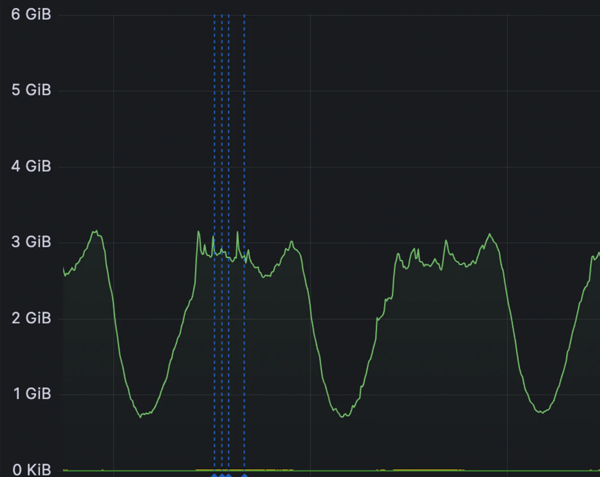
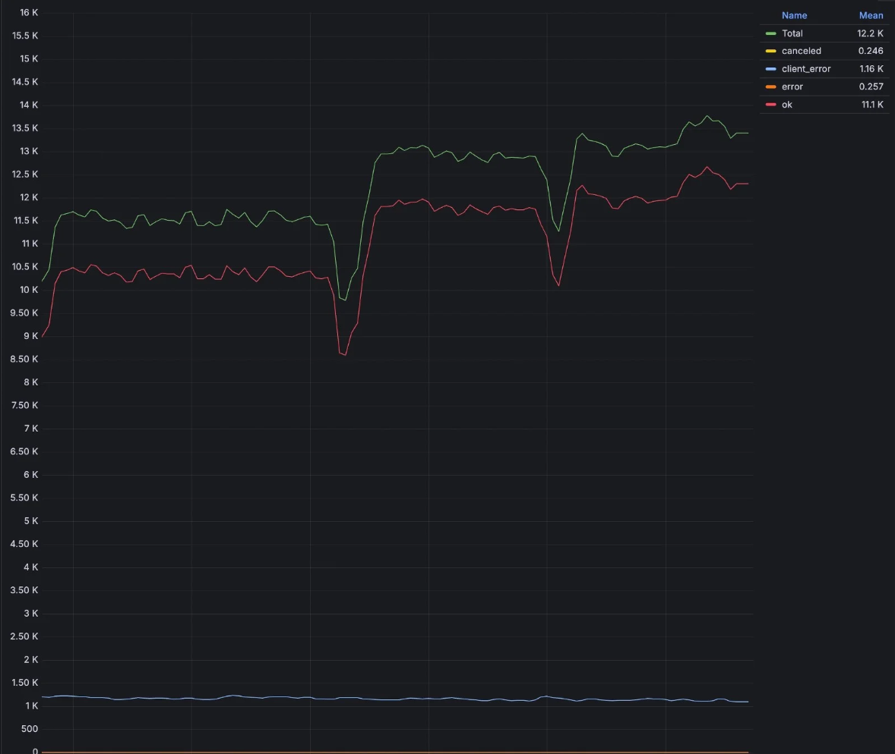
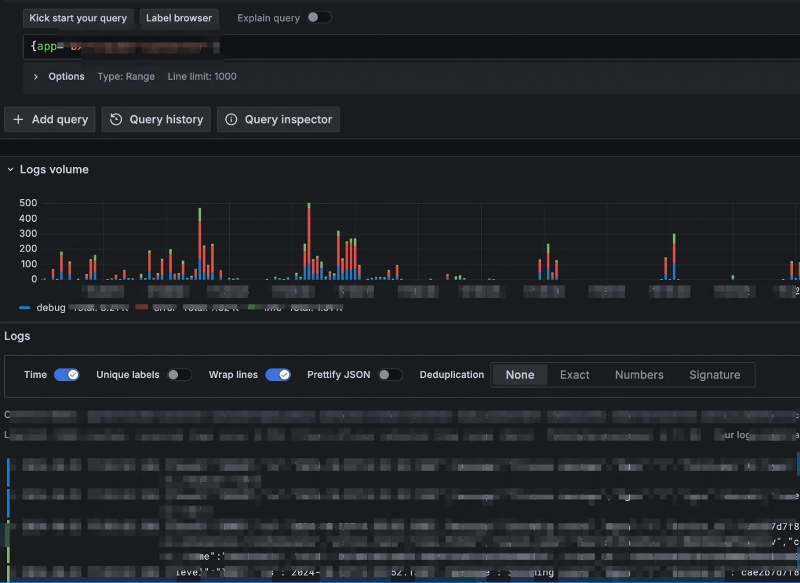
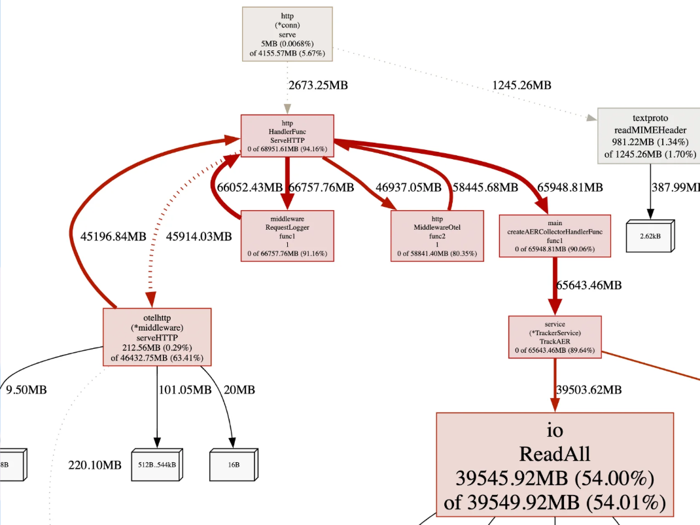
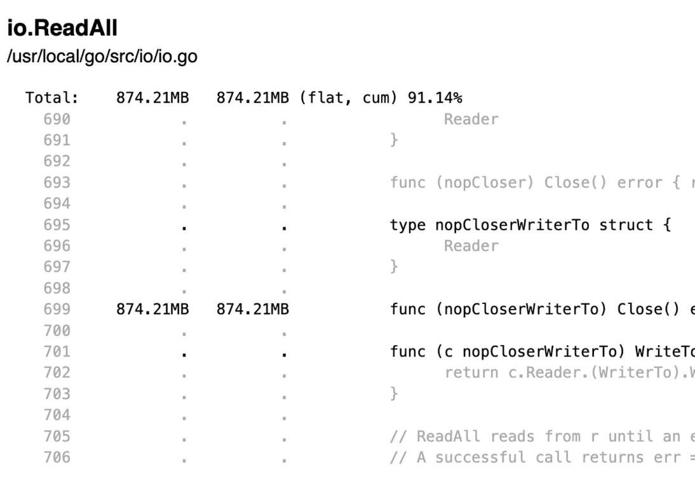

<!-- _class: lead -->
<!-- _paginate: false -->
<!-- _footer: "" -->

# pprof в Go

Как найти утечку памяти, пока процесс ещё жив

Инцидент с прода, демо `*_leaks`, diff двух профилей

---

# О чём поговорим

1. Разбор инцидента на проде
2. План разбора: метрики, логи, горутины, pprof
3. Разберём причины утечек памяти
4. Diff двух профилей
5. Шпаргалка: heap, CPU, goroutine, diff
6. Частые причины роста памяти

---

<!-- _class: shot -->

# Память росла до лимита пода

<div class="columns">
<div>

Рестарт возвращал сервис ненадолго.

График памяти — повод открыть разбор. Откуда байты, на нём ещё не написано.

</div>
<div>



</div>
</div>

---

# План разбора

**1. Метрики: RPS, ошибки, размер тела**
Память и горутины — на том же окне. Прямая вверх при ровном RPS и ровном размере тела — накопление. Полка после пика — рабочий объём кэша или пула соединений.

**2. Логи**
Паника, таймауты, обрывы соединений к downstream.

**3. Состояние горутин**
Число и стеки, повторённые тысячи раз.

**4. pprof на проде**
heap и goroutine снимаем, пока процесс жив. Дальше Graph и Source.

---

<!-- _class: shot -->

# Шаг 1. RPS, ошибки, размер тела

<div class="columns">
<div>

RPS объясняет рост только вместе с размером ответа и ошибками.

Ровный трафик и растущая память — идём в логи и рантайм, а не в масштабирование.

</div>
<div>



</div>
</div>

---

<!-- _class: shot -->

# Шаг 2. Логи

<div class="columns">
<div>

Ищем панику, таймауты, `connection reset`, рост времени downstream.

Дальше смотрим горутины и в том случае, когда в логах тихо: незакрытый Body часто молчит до исчерпания памяти или файловых дескрипторов.

</div>
<div>



</div>
</div>

---

# Шаг 3. Состояние горутин

- Метрика числа горутин рядом с графиком памяти
- Дамп: `/debug/pprof/goroutine?debug=1`
- Утечка — повторяющийся стек с большим счётчиком
- У клиента с незакрытым Body их два: `readLoop` и `writeLoop`. `conn.serve` живёт в downstream

`debug=1` группирует одинаковые стеки и печатает счётчик. `debug=2` печатает каждую горутину отдельно в формате паники: причину ожидания, аргументы кадров шестнадцатеричными словами и примерные минуты ожидания. Минуты считаются от первого GC, заставшего горутину заблокированной, и печатаются от одной. Повторяющиеся стеки удобнее искать в `debug=1`.

Несколько `readLoop` — обычный пул keep-alive. Тысячи при ровном RPS — соединения не возвращаются в пул.

---

<!-- _class: shot -->

# Шаг 4. Граф pprof

<div class="columns">
<div>

Профиль heap, режим Graph. Сначала смотрим sample: `inuse_space` — живые байты на последний GC, `alloc_space` — всё выделенное со старта.

Крупный шрифт — большой flat: функция сама выделила байты. Красный — большой cum. От узла переходим в Source.

Для Graph на машине нужен `dot` из Graphviz. Top, Flame Graph и Source работают и без него.

</div>
<div>



</div>
</div>

---

<!-- _class: shot -->

# Шаг 4. Режим Source

<div class="columns">
<div>

Graph называет функцию. Source раскладывает flat и cum по строкам: в heap flat стоит на строке аллокации.

Исходники pprof берёт с локального диска. На скрине 874 MB стоят на `io.go:699`, где в Go 1.22+ `nopCloserWriterTo.Close`. В Go 1.20 это строка `append` внутри `ReadAll`. Версия Go на машине должна совпадать с версией сборки.

Вызов, который забыл `Close`, может быть выше по стеку аллокации или уже вернулся. В профиле горутин cum своей функции стоит на строке, где горутина заблокирована.

</div>
<div>



</div>
</div>

---

# Причина: Body ответа не закрыт

Исходящий ответ получен, тело не дочитано и не закрыто. Соединение осталось за процессом вместе с горутинами `net/http`.

Признак в профиле горутин — тысячи `persistConn.readLoop` и `writeLoop`. В heap по `inuse_space` рядом `bufio` и `Transport.dialConn`.

---

# Почему это держит память

`Client.Get` создаёт запрос через `NewRequest`. Если в пуле `Transport` есть свободное соединение, запрос идёт по нему, если нет — открывается новое. `readLoop` ждёт EOF или `Close`. `writeLoop` ждёт следующую запись или закрытие соединения.

GC их не забирает: стек горутины — живой корень. Пока соединение не отпущено, `conn.serve` у downstream ждёт следующий запрос.

`NewRequest` берёт `context.Background`. Отмена входящего запроса это соединение не закрывает.

---

<!-- _class: lead -->

# Причины утечек

Рассмотрим другие причины утечек памяти в Go: горутина, Transport, context, Rows, транзакция.

Шесть сервисов `*_leak`. Нагрузка снаружи, чтобы на счётчиках и в pprof было видно, как течь растёт.

---

# Шесть процессов, один compose

| Сервис | Порт | На `/leak` |
| --- | --- | --- |
| `http_leak` | 8080 | `resp.Body` не закрыт |
| `goroutine_leak` | 8091 | горутина блокируется на канале |
| `client_leak` | 8092 | новый `Transport` на запрос |
| `ctx_leak` | 8093 | `cancel` не вызван |
| `db_leak` | 8094 | `sql.Rows` не закрыты |
| `tx_leak` | 8095 | транзакция без `Commit` и `Rollback` |

k6 отбрасывает тела ответов (`discardResponseBodies`) и сам память не копит. `/fixed` делает тот же вызов без утечки. pprof у каждого свой, например `127.0.0.1:8080/debug/pprof/`.

`db_leak` и `tx_leak` ходят каждый в свой Postgres. С хоста они доступны на `127.0.0.1:5433` и `127.0.0.1:5434`. У обоих `max_connections` = 100.

---

# Нагрузка

```bash
TARGET_PATH=/fixed DURATION=30s docker compose up -d
docker compose down && docker compose up -d
```

Второй запуск две минуты бьёт в `/leak` на всех шести: 50 RPS в `http_leak`, по 20 в горутины, клиент и контекст, по 10 в базу и транзакции. У базы и транзакций рост около 10 секунд: дальше `max_connections` = 100, `/leak` отвечает 502, счётчики встают.

Лог самого шумного: `docker compose logs -f http_leak`. У остальных контейнер называется так же, как сервис.

`(+N)` считается от старта процесса и пишется в лог. `GET /gc` делает сборку мусора и печатает снимок без `(+N)`. У `db_leak` в этой строке ещё `conns_in_use` и `pg_idle`, у `tx_leak` — `conns_in_use`, `pg_idle_in_tx` и `pg_xmin`. Сравниваем `/fixed` и `/leak` на свежем процессе: уже открытые соединения и горутины живут до его завершения.

---

<!-- _class: dense -->

# `http_leak` при 50 RPS

`/fixed` держится на полке. Здесь и ниже из строк лога убраны `stack`, `sys` и `gc`:

```text
goroutines=   10 (   +7)  heap_inuse=   1MiB
```

`/leak` прибавляет около 300 горутин на строку: 50 запросов в секунду × 3 горутины × 2 секунды. Строки взяты выборочно:

```text
goroutines=    5 (   +2)  heap_inuse=   1MiB
goroutines=  400 ( +397)  heap_inuse=   6MiB
goroutines= 1600 (+1597)  heap_inuse=  18MiB
goroutines= 3305 (+3302)  heap_inuse=  28MiB
```

Последняя строка — около 22 секунд нагрузки, затем остановка и GC. Счётчик остался. За две минуты тот же темп даёт около 18 тысяч горутин. Остальные сервисы при своих RPS растут медленнее и по-разному.

---

<!-- _class: dense tight -->

# `http_leak`: Body не закрыт

```go
func leakyCall(url string) error {
    resp, err := client.Get(url)
    if err != nil {
        return err
    }
    if resp.StatusCode != http.StatusOK {
        return fmt.Errorf("downstream: %s", resp.Status)
    }
    return nil
}

func fixedCall(url string) error {
    resp, err := client.Get(url)
    if err != nil {
        return err
    }
    defer resp.Body.Close()
    if resp.StatusCode != http.StatusOK {
        return fmt.Errorf("downstream: %s", resp.Status)
    }
    _, err = io.Copy(io.Discard, resp.Body)
    return err
}
```

`leakyCall` смотрит только на статус: Body не дочитан и не закрыт. В `fixedCall` `Close` отпускает соединение, чтение до EOF возвращает его в пул.

---

<!-- _class: dense tight -->

# `goroutine_leak`: канал без читателя

```go
func leaky() []byte {
    out := make(chan []byte)
    go func() {
        out <- render()
    }()
    select {
    case b := <-out:
        return b
    case <-time.After(timeout):
        return nil
    }
}
```

`render` в демо дольше `timeout`, обработчик уходит по таймауту. Читателя у `out` больше нет, отправка в небуферизованный канал блокируется навсегда. Стек горутины — живой корень. В кадре заголовок среза, сами 4 КБ лежат в куче и из кадра достижимы.

В профиле горутин стек сверху вниз: `runtime.gopark`, `runtime.chansend`, `runtime.chansend1`, `main.leaky.func1`. В `debug=1` runtime-кадры сверху скрыты, первым идёт `main.leaky.func1`. При 20 RPS лог прибавляет около 40 горутин за две секунды.

В `/fixed` канал `make(chan []byte, 1)`: горутина кладёт значение в буфер и выходит.

---

# `client_leak`: свой Transport на запрос

```go
func leakyCall(url string) error {
    client := &http.Client{Transport: &http.Transport{}}
    return do(client, url)
}
```

`do` закрывает Body и читает его до EOF. У нулевого `Transport` `IdleConnTimeout` равен 0: ноль значит «без ограничения», по простою соединение не закрывается.

Имена кадров те же: `readLoop`, `writeLoop`, `conn.serve`. Body уже закрыт, соединение лежит в пуле этого `Transport`, и `readLoop` ждёт данных из сокета в `bufio.(*Reader).Peek`. У `http_leak` он ждёт в `select`, пока прочитают Body. В heap виден `http.Transport` из `leakyCall`. Объект маленький, профиль показывает место аллокации выборкой.

`/fixed` создаёт клиент один раз при старте, с ненулевым `IdleConnTimeout`. Пустой `Client.Transport` — это общий `DefaultTransport`.

---

<!-- _class: dense tight -->

# `ctx_leak`: `cancel` не вызван

```go
func leaky(w io.Writer) error {
    ctx, cancel := context.WithCancel(appCtx)
    go func() {
        <-ctx.Done()
    }()
    if _, err := fmt.Fprintln(w, "ok"); err != nil {
        cancel()
        return err
    }
    return nil
}
```

`cancel` вызывают только на ветке ошибки. `appCtx` живёт до конца процесса и держит дочерний контекст, пока не вызовут `cancel`. Горутина стоит на `<-ctx.Done()`. `go vet` ловит этот путь: «the cancel function is not used on all paths (possible context leak)».

Профиль горутин показывает замыкание: обработчик уже вернулся, горутина — нет. Heap растёт медленно: на запрос в куче сотни байт — контекст, канал `Done`, структура горутины из `runtime.malg`. Стек горутины считается в `stack`, не в heap-профиле. При 20 RPS это около 40 горутин за две секунды.

`/fixed` делает `defer cancel()` сразу после `WithCancel`.

---

<!-- _class: dense -->

# `db_leak`: `Rows` не закрыты

```go
func leaky(db *sql.DB) ([]item, error) {
    rows, err := db.QueryContext(context.Background(), query)
    if err != nil {
        return nil, err
    }
    var items []item
    for rows.Next() {
        var it item
        if err := rows.Scan(&it.ID, &it.Name, &it.Payload); err != nil {
            return nil, err
        }
        items = append(items, it)
        if len(items) == pageSize {
            break //Выходим из цикла, чтобы не вызывать Next
        }
    }
    return items, rows.Err()
}
```

Обычный цикл: строки мапятся в `item` и складываются в слайс. В таблице 8 строк, `pageSize` = 5, цикл выходит по `break`. `Close` нет.

---

<!-- _class: dense -->

# Когда `Rows` отдают соединение

`QueryContext` берёт соединение из пула и отдаёт его `Rows`. В пул оно вернётся, только когда `Rows` закроют. Закрываются они в четырёх случаях:

- явный `rows.Close()`
- `Next` вернул `false` в конце выборки, и следующего набора строк нет
- `Next` получил ошибку драйвера
- отменили контекст запроса: `Rows` закрывает горутина `awaitDone`. Её запускают, только если у контекста есть `Done`

`break`, `return` при ошибке `Scan` или маппинга, паника в цикле — ни один из этих выходов `Rows` не закрывает. Финализатора у `Rows` нет: если они стали мусором незакрытыми, соединение остаётся занятым. `DB` хранит его в своём реестре и считает в `InUse`.

---

<!-- _class: dense -->

# `db_leak`: что происходит в демо

`break` срабатывает раньше, чем `Next` вернёт `false`. Контекст `Background`, поэтому горутины `awaitDone` нет. После выхода из `leaky` переменная `rows` недостижима, а соединение так и остаётся занятым.

Горутины почти стоят. В логе растут `conns_in_use` и `pg_idle`, пока есть слоты. `pg_idle` считает idle-сессии базы, кроме той, с которой снимаем статистику, и на утечке идёт рядом с `conns_in_use`. На сервере сессия `idle`: запрос завершён, `pg_idle_in_tx` и `pg_xmin` остаются 0. Около 100 соединений Postgres отказывает, счётчики встают. В heap видны `pgx` и `database/sql`. `GET /gc` эти счётчики не уменьшает.

`/fixed` отличается одной строкой: `defer rows.Close()`. `break` остаётся, `Close` отпускает соединение на любом выходе из функции. Страницу правильнее резать через `LIMIT` в SQL, но `defer rows.Close()` нужен и тогда: выход по ошибке `Scan` тоже не закрывает `Rows`.

---

<!-- _class: dense -->

# Транзакция без `Commit` и `Rollback`

`BeginTx` держит соединение пула, пока нет `Commit` или `Rollback`. `Begin` и `BeginTx(context.Background())` не отменяются вместе с входящим запросом.

`database/sql` на каждую транзакцию запускает `(*Tx).awaitDone`. Горутина стоит на `ctx.Done()`. В логе растут `conns_in_use`, число горутин, `pg_idle_in_tx` и `pg_xmin`. После `GET /gc` `heap_inuse` остаётся в единицах МиБ: транзакций не больше 100, а стеки горутин в `heap_inuse` не входят.

Для базы это отдельный ущерб:

- сессия `idle in transaction` занимает слот. В демо `max_connections` = 100, слоты кончаются раньше памяти приложения
- `INSERT` новой строки держит xid и табличный `RowExclusiveLock` до конца транзакции. Соседний `INSERT` проходит, строка снаружи не видна
- открытая транзакция не даёт `VACUUM` убрать недавно умершие версии строк. В демо у сессии есть и xid, и снимок: `pg_xmin` растёт вместе с `pg_idle_in_tx`. Если снимка нет, `backend_xmin` пуст, тогда смотрят `backend_xid`
- этот `RowExclusiveLock` заставляет ждать `VACUUM FULL`, `DROP`, `TRUNCATE` и большинство форм `ALTER TABLE`. `UPDATE` существующей строки держал бы ещё блокировку самой строки

---

<!-- _class: dense -->

# `tx_leak`: транзакция не закрыта

```go
func leaky(db *sql.DB, payload string) error {
    tx, err := db.BeginTx(context.Background(), nil)
    if err != nil {
        return err
    }
    if _, err := tx.ExecContext(context.Background(), insertEvent, payload); err != nil {
        _ = tx.Rollback()
        return err
    }
    var n int
    if err := tx.QueryRowContext(context.Background(), countEvents, payload).Scan(&n); err != nil {
        _ = tx.Rollback()
        return err
    }
    // Дубль не сохраняем.
    if n > 1 {
        return nil
    }
    return tx.Commit()
}
```

---

<!-- _class: dense -->

# `tx_leak`: что происходит в демо

`Rollback` расставлен вручную на каждой ветке, а ветку с дублем пропустили: она выходит без `Commit` и `Rollback`. Первый запрос коммитит `signup`, каждый следующий видит дубль и оставляет транзакцию открытой.

Сама она не откатится. `*sql.Tx` держит горутина `awaitDone`: она ждёт отмены контекста транзакции, а его отменяют только `Commit`, `Rollback` или родительский контекст. `Background` не отменяется никогда.

При 10 RPS за две секунды около +20 горутин, `conns_in_use`, `pg_idle_in_tx` и `pg_xmin`, пока есть слоты. `conns_in_use` встаёт на 100, дальше Postgres отвечает отказом. `GET /gc` счётчики не уменьшает.

`/fixed` ставит `defer tx.Rollback()` сразу после `BeginTx` вместо ручных `Rollback`. Ветка с дублем откатывается, а после `Commit` отложенный `Rollback` возвращает `ErrTxDone` и ничего не делает.

---

# Какой профиль открывать

| Вопрос | Профиль |
| --- | --- |
| Кто не завершился | `goroutine` |
| Какие объекты ещё живы | `heap`, sample `inuse_space` |
| Кто давит на GC | diff `heap` по `alloc_space`, или `/allocs` |
| Кто ест CPU | `/debug/pprof/profile?seconds=20` |

```bash
go tool pprof -http=127.0.0.1:9091 http://127.0.0.1:8080/debug/pprof/goroutine
go tool pprof -http=127.0.0.1:9090 http://127.0.0.1:8080/debug/pprof/heap
```

У `db_leak` горутины почти стоят: смотрите `conns_in_use` и heap. У `tx_leak` рядом с `conns_in_use` растёт `(*Tx).awaitDone`. У `ctx_leak` горутины растут, а heap почти не меняется.

На этих утечках CPU-профиль почти пустой: горутины спят. Их показывает профиль горутин.

---

<!-- _class: dense -->

# Diff двух профилей

Пока k6 стучит в `/leak`:

```bash
curl -fsS http://127.0.0.1:8080/debug/pprof/goroutine \
  -o profiles/goroutine1.pb.gz
sleep 20
curl -fsS http://127.0.0.1:8080/debug/pprof/goroutine \
  -o profiles/goroutine2.pb.gz
```

```bash
go tool pprof -top -cum -base \
  profiles/goroutine1.pb.gz profiles/goroutine2.pb.gz

go tool pprof -http=127.0.0.1:9091 -diff_base \
  profiles/goroutine1.pb.gz profiles/goroutine2.pb.gz
```

Оба флага вычитают первый файл из второго и работают и в `-top`, и в `-http`. В `-top -cum` колонка cum — сколько стеков прибавилось.

`-diff_base` считает проценты от базового снимка, поэтому они легко больше 100%: читайте абсолютные числа. Flame Graph с ним закрашивает прирост красным, убыль зелёным. `-base` документация pprof советует для накопительных профилей одного процесса.

---

<!-- _class: dense -->

# Как читать diff `http_leak`

Три стека, которые расходятся при 50 RPS примерно на число запросов за окно:

- `net/http.(*persistConn).readLoop` — клиент ждёт EOF или `Close`
- `net/http.(*persistConn).writeLoop` — клиент ждёт следующую запись
- `net/http.(*conn).serve` — downstream в том же процессе ждёт следующий запрос

За 20 секунд это около тысячи каждого.

В heap по `inuse_space` рядом растут `bufio.NewReaderSize`, `bufio.NewWriterSize` и `Transport.dialConn`.

`alloc_space` за ту же паузу часто показывает сам сбор профиля: `runtime/pprof`, `compress/flate`. Для утечки берём `inuse_space`.

В демо `runtime.MemProfileRate` = 64 КБ: в среднем один сэмпл на 64 КБ выделенного. По умолчанию — 512 КБ, мелкие буферы попадают реже. Профиль горутин учитывает все горутины.

---

<!-- _class: dense -->

# Diff на остальных сервисах

Пару снимков со всех шести снимает `./scripts/capture-profiles.sh`, UI для одного — `./scripts/pprof-diff.sh client_leak goroutine`.

| Сервис | Goroutine | Heap `inuse_space` |
| --- | --- | --- |
| `http_leak` | `readLoop`, `writeLoop`, `conn.serve` | `bufio`, `dialConn` |
| `goroutine_leak` | `chansend` и замыкание `leaky` | `bytes.Repeat` |
| `client_leak` | те же три кадра, `readLoop` в `Peek` | плюс `http.Transport` |
| `ctx_leak` | приём из `ctx.Done()` | мало: `runtime.malg`, `context` |
| `db_leak` | новой широкой полосы нет | `pgx`, `database/sql` |
| `tx_leak` | `(*Tx).awaitDone` | мало: буферы `pgx` |

`readLoop` у `http_leak` и `client_leak` расходятся ниже по стеку: у первого `runtime.selectgo` (ждёт Body), у второго `bufio.(*Reader).Peek` (соединение в пуле). Heap добавляет второй признак: в `client_leak` на запрос появляется `Transport`.

Пустой goroutine-diff при растущем `conns_in_use` — это `db_leak`: смотрите heap и статистику пула. У `tx_leak` рядом растёт `awaitDone`.

---

<!-- _class: dense -->

# Шпаргалка pprof

| Профиль | Откуда | Зачем |
| --- | --- | --- |
| **heap** | `/debug/pprof/heap` | Живые объекты. Утечка — рост `inuse_space` |
| **cpu** | `/debug/pprof/profile?seconds=20` | Кто занимает процессор |
| **goroutine** | `/debug/pprof/goroutine` | Какие стеки не завершаются |
| **diff** | `-base` или `-diff_base` | Что изменилось между двумя снимками |

Режимы UI: **Top**, **Graph**, **Flame Graph**, **Source**.

`allocs` / `alloc_space` включают уже собранный мусор и копят байты со старта процесса. Давление за окно — diff двух снимков.
CPU-профиль добавляет накладные расходы: их стоит измерить до включения на проде. Снимайте pprof с localhost или с admin-порта.
Ещё есть `block` и `mutex`: оба выключены, пока их явно не включат в рантайме.

---

<!-- _class: dense -->

# Частые причины роста памяти

1. **Горутины** запускаются на запрос и не выходят: канал, `WaitGroup`, вызов без таймаута
2. **Новый `Transport` на запрос** с нулевым `IdleConnTimeout`: простой без предела. Пустой `Client.Transport` — общий `DefaultTransport`
3. **`resp.Body`** не закрыт
4. **`sql.Rows` без `Close`** и **`Tx` без `Commit`/`Rollback`** держат соединение базы. Файл без `Close` держит дескриптор: финализатор может закрыть его после сборки, срок не гарантирован
5. **Map, кэш, очередь** без верхней границы и без TTL
6. **Вечный `time.Tick` / `NewTicker`.** Горутина держит тикер. При `go 1.23+` в `go.mod` тикер без ссылок собирает GC
7. **Короткий срез** удерживает большой backing array
8. **`cancel` не вызван.** `WithCancel` от долгого родителя держит дочерний контекст, пока родитель не отменён. Горутина на `ctx.Done()` не выходит. `WithTimeout` без `cancel` держит таймер до дедлайна

Прямая вверх при ровном RPS — накопление. Полка после GC — кэш или пул соединений. `sync.Pool` отдаёт объекты сборщику: с Go 1.13 они переживают одну сборку в victim cache и уходят на следующей. RSS пода может остаться выше `heap_inuse`.

---

<!-- _class: dense -->

# Чего в демо нет

**Map без потолка и TTL.** Ключ живёт, пока его явно не удалят.

```go
var cache = map[string][]byte{}

func put(id string, body []byte) { cache[id] = body }
```

**Вечный `time.Tick`.** Цикл держит канал, тикер живёт вместе с горутиной. Память растёт, если такой `poll` запускают на каждый запрос или объект. При `go 1.23+` в `go.mod` тикер без ссылок забирает сборщик, `Stop` останавливает его раньше.

```go
func poll() {
    for range time.Tick(time.Second) {
        work()
    }
}
```

**Короткий срез.** `buf[:8]` держит весь backing array. `append([]byte(nil), buf[:8]...)` оставляет только голову.

---

<!-- _class: lead -->

# Что уносим с собой

1. Метрики: память против RPS, ошибок и размера тела
2. Логи, затем число и стеки горутин
3. pprof с живого процесса: goroutine, heap, Source
4. Diff двух снимков при том же RPS
5. На ревью: один `Transport` с ненулевым `IdleConnTimeout`, `defer Close` у Body и Rows, `defer Rollback()` у `Tx`, чтение до EOF, `defer cancel()` у контекста, буфер у канала результата, который могут не дочитать

Если процесс уже перезапустился, в разовом профиле утечки уже нет. Постоянный сбор тех же профилей оставляет снимки до рестарта.

---

<!-- _class: refs -->

# Источники: HTTP

Строки исходников — Go 1.23.1, версия из Dockerfile. Ссылки ведут на тег `go1.23.1`.

## `http_leak`: Body не закрыт

- [net/http: `Client.Do`](https://pkg.go.dev/net/http#Client.Do) — «Body which the user is expected to close. If the Body is not both read to EOF and closed, the Client's underlying RoundTripper (typically Transport) may not be able to re-use a persistent TCP connection»
- [`response.go:59–64`](https://github.com/golang/go/blob/go1.23.1/src/net/http/response.go#L59-L64) — «It is the caller's responsibility to close Body»
- [`transport.go:2322–2340`](https://github.com/golang/go/blob/go1.23.1/src/net/http/transport.go#L2322-L2340) — `readLoop` ждёт в `select`: Body дочитан или закрыт, отменён контекст запроса, закрыто соединение

## `client_leak`: свой `Transport` на запрос

- [net/http: `Transport`](https://pkg.go.dev/net/http#Transport) — «Transports should be reused instead of created as needed». Про `Client` то же: [`client.go:33–35`](https://github.com/golang/go/blob/go1.23.1/src/net/http/client.go#L33-L35)
- [`transport.go:220–224`](https://github.com/golang/go/blob/go1.23.1/src/net/http/transport.go#L220-L224) — `IdleConnTimeout`: «Zero means no limit»
- [`transport.go:2205`](https://github.com/golang/go/blob/go1.23.1/src/net/http/transport.go#L2205) — у простаивающего соединения `readLoop` ждёт в `pc.br.Peek(1)`

---

<!-- _class: refs -->

# Источники: горутины и контекст

## `goroutine_leak`: канал без читателя

- [Спецификация Go: Send statements](https://go.dev/ref/spec#Send_statements) — «Communication blocks until the send can proceed. A send on an unbuffered channel can proceed if a receiver is ready. A send on a buffered channel can proceed if there is room in the buffer.»
- [Go blog: Pipelines, Stopping short](https://go.dev/blog/pipelines#stopping-short) — «Goroutines are not garbage collected; they must exit on their own.»
- [Go blog: Timing out, moving on](https://go.dev/blog/concurrency-timeouts) — «The timeout channel is buffered with space for 1 value, allowing the timeout goroutine to send to the channel and then exit.»
- [`runtime/chan.go:270`](https://github.com/golang/go/blob/go1.23.1/src/runtime/chan.go#L270) — `chansend` паркует горутину через `gopark` с `waitReasonChanSend`. Это кадры `runtime.chansend` и `runtime.gopark` в профиле

## `ctx_leak`: `cancel` не вызван

- [context: обзор пакета](https://pkg.go.dev/context#pkg-overview) — «Calling the CancelFunc cancels the child and its children, removes the parent's reference to the child, and stops any associated timers. Failing to call the CancelFunc leaks the child and its children until the parent is canceled or the timer fires. The go vet tool checks that CancelFuncs are used on all control-flow paths.»
- [`context.go:488`](https://github.com/golang/go/blob/go1.23.1/src/context/context.go#L488) — `propagateCancel` записывает дочерний контекст в `children` родителя: `appCtx` держит его, пока не вызовут `cancel`

---

<!-- _class: refs -->

# Источники: база

## `db_leak`: `Rows` не закрыты

- [Go: Querying for data, multiple rows](https://go.dev/doc/database/querying#multiple_rows) — «Looping all the way through the rows also closes it implicitly, but it is better to use defer to make sure rows is closed no matter what.»
- [database/sql: `Rows.Close`](https://pkg.go.dev/database/sql#Rows.Close) — «If Rows.Next is called and returns false and there are no further result sets, the Rows are closed automatically»
- [`sql.go:2922`](https://github.com/golang/go/blob/go1.23.1/src/database/sql/sql.go#L2922) — `Rows` владеет соединением: «owned; must call releaseConn when closed to release». [`sql.go:3044–3077`](https://github.com/golang/go/blob/go1.23.1/src/database/sql/sql.go#L3044-L3077) — `nextLocked` закрывает на EOF и ошибке драйвера. [`sql.go:3391–3396`](https://github.com/golang/go/blob/go1.23.1/src/database/sql/sql.go#L3391-L3396) — ошибка `Scan` `Rows` не закрывает

## `tx_leak`: транзакция не закрыта

- [Go: Executing transactions, example](https://go.dev/doc/database/execute-transactions#example) — «Defer the transaction's rollback. If the transaction succeeds, it will be committed before the function exits, making the deferred rollback call a no-op.»
- [database/sql: `Tx`](https://pkg.go.dev/database/sql#Tx) — «A transaction must end with a call to Tx.Commit or Tx.Rollback». [`sql.go:1917`](https://github.com/golang/go/blob/go1.23.1/src/database/sql/sql.go#L1917) — `go tx.awaitDone()`, [`sql.go:2199–2214`](https://github.com/golang/go/blob/go1.23.1/src/database/sql/sql.go#L2199-L2214) — горутина ждёт `tx.ctx.Done()`
- PostgreSQL 16: [`idle_in_transaction_session_timeout`](https://www.postgresql.org/docs/16/runtime-config-client.html#GUC-IDLE-IN-TRANSACTION-SESSION-TIMEOUT) — «an open transaction prevents vacuuming away recently-dead tuples that may be visible only to this transaction». [Table-level locks](https://www.postgresql.org/docs/16/explicit-locking.html#LOCKING-TABLES) — с чем конфликтует `ROW EXCLUSIVE`
